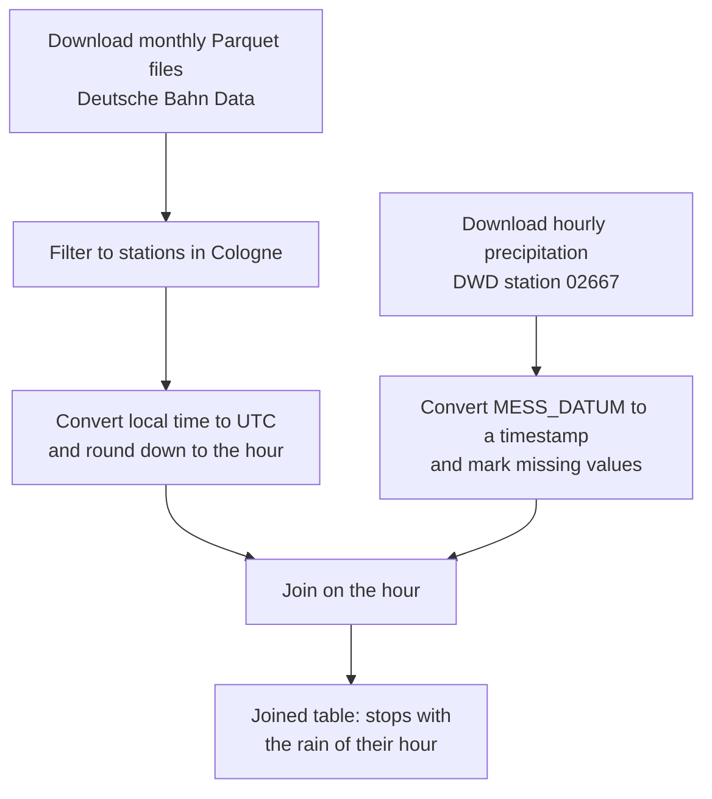

# Lab 1 · Part C · Dataset profile: Deutsche Bahn delays in Cologne

## Task 5 · Find a dataset

### Where I searched

| Source | Kind | Search term | Hits | Useful? |
| --- | --- | --- | --- | --- |
| [Open.NRW](https://open.nrw) (includes Offene Daten Köln) | State and city portal | `Verspätung` | 1 | No: only live bus positions in Münster under a closed licence |
| [Open.NRW](https://open.nrw) | State and city portal | `kvb` | 8 | No delay data: only lifts, escalators, ticket offices and bike rental of the Cologne transport company KVB |
| [GovData](https://www.govdata.de) | National portal | `Pünktlichkeit` | 3 | Partly: two datasets on the punctuality of regional trains, but only in Schleswig-Holstein, not in Cologne; the third hit is unrelated |
| [GovData](https://www.govdata.de) | National portal | `deutsche bahn` | 36 | No delay data, but stations and the rail network |
| [Hugging Face](https://huggingface.co/datasets?search=deutsche-bahn) | Repository | `deutsche-bahn` | 8 | Yes: `piebro/deutsche-bahn-data` |

Public portals have no historical train delay data for Cologne; the useful archives are collected by private projects from Deutsche Bahn's public timetable API.

### Searching like a machine

[GovData API: `q=deutsche bahn`](https://www.govdata.de/ckan/api/3/action/package_search?q=deutsche%20bahn&rows=1)

- **Hits (`count`):** 36 (as of 10.11.26)
- **First hit:** Haltestellen Deutsche Bahn
- **Licence:** `license_id` is empty for the whole dataset; the licence (CC BY 4.0) is given for each file under `resources`.

### My choice

[piebro/deutsche-bahn-data](https://huggingface.co/datasets/piebro/deutsche-bahn-data): historical arrivals and departures with delays and cancellations, collected from Deutsche Bahn's public timetable API, as monthly Parquet files. The original publisher is Deutsche Bahn, but its API only shows current data, so this archive is the only way to get past months.

The data covers all of Germany, so I filter it to Cologne: in October 2026, it contains 25 stations in Cologne, for example Köln Hbf, Köln Messe/Deutz and Köln-Ehrenfeld. Until early November 2025, the archive only covers the ~100 biggest stations in Germany, so complete data for all Cologne stations starts in November 2025.

## Task 6 · Profile the dataset

### 1. Facts

| | Deutsche Bahn Data |
| --- | --- |
| Publisher | [piebro](https://github.com/piebro/deutsche-bahn-data) on Hugging Face; original publisher: Deutsche Bahn (public timetable API) |
| Link | [huggingface.co/datasets/piebro/deutsche-bahn-data](https://huggingface.co/datasets/piebro/deutsche-bahn-data) |
| Formats | Parquet (monthly processed files); the raw API responses are also available as Parquet |
| Size | 28 monthly files (2024-07 to 2026-10). The file for October 2026 has 369 MB, 15,211,477 rows and 23 columns; 218,119 of these rows are stops in Cologne |
| Coverage | Germany, from July 2024; one row per train stop (arrival and/or departure at a station). Until early November 2025 only the ~100 biggest stations, since then all stations; 25 stations in Cologne in October 2026 |
| Last update | 10.11.26; one new file per month |
| Licence | CC BY 4.0, stated "by Deutsche Bahn" in the README and in the metadata (`license: cc-by-4.0`) |

### 2. Stars

★★★: openly licensed, structured, and in an open, machine-readable format (Parquet). For the fourth star, stations and trains would need URIs; the dataset only uses codes such as the EVA station number `08000207` for Köln Hbf.

### 3. Open the data

I opened `data-2026-10.parquet` with DuckDB in Python, because LibreOffice cannot read Parquet, and filtered it to stations whose name starts with "Köln" (218,119 rows).

| Column | Minimum | Maximum | Mean |
| --- | --- | --- | --- |
| `delay_in_min` | −61 | 503 | 5.77 |
| `train_line_station_num` | 1 | 104 | 10.8 |

- **Empty cells:** `line_number` is empty in 8,142 rows. The README explains why: long-distance trains (ICE, IC, EC) have no line number.
- **Odd things:**
  - The README documents 18 columns, but the file has 23: `is_additional_stop`, `is_replacement_train`, `replaced_train_type`, `replaced_train_number` and `has_plan_record` are not documented.
  - 1,006 stops have a negative delay, down to −61 minutes; a train an hour early is unlikely, so these may be errors.
  - The maximum of 503 minutes is the night train NJ 469 at Köln Hbf on 24 October 2026.
  - 73 rows have no train type, train number and delay.
  - Köln Messe/Deutz appears with two EVA numbers (`08003368` and `08073368`).
  - The timestamps have no time zone.
- **Tool:** DuckDB (Python).

### 4. Data dictionary

| Column | Meaning | Type and unit | Example |
| --- | --- | --- | --- |
| `station_name` | Name of the station | text | `Köln Hbf` |
| `eva` | EVA number, the station's code at Deutsche Bahn | text (8 digits) | `08000207` |
| `train_type` | Type of train | text | `ICE`, `RE`, `S` |
| `delay_in_min` | Delay at this stop | integer, minutes | `101` |
| `time` | Actual time of arrival or departure | timestamp, no time zone | `2026-10-01 00:03:00` |

The publisher documents the columns in a schema table in the [README](https://huggingface.co/datasets/piebro/deutsche-bahn-data/blob/main/README.md), but five columns are missing there.

### 5. Licence

Yes, the dataset is open: CC BY 4.0 conforms to the Open Definition. When I reuse it, I must credit the source, link the licence and say if I changed the data, for example by filtering it to Cologne.

Attribution line (TASL):

> "Deutsche Bahn Data" by Deutsche Bahn, collected by piebro, [huggingface.co/datasets/piebro/deutsche-bahn-data](https://huggingface.co/datasets/piebro/deutsche-bahn-data), licensed under [CC BY 4.0](https://creativecommons.org/licenses/by/4.0/). Filtered to stations in Cologne.

### 6. People

The data contains no personal data: it describes trains,

## Task 7 · Review it with the FAIR principles

| Principle | Rating | Evidence |
| --- | --- | --- |
| F1 | ~ | A stable URL, [huggingface.co/datasets/piebro/deutsche-bahn-data](https://huggingface.co/datasets/piebro/deutsche-bahn-data), but no DOI (`"doi": null` in the [Hugging Face API](https://huggingface.co/api/datasets/piebro/deutsche-bahn-data)) |
| F2 | ~ | Title, description, tags and licence are in the [README](https://huggingface.co/datasets/piebro/deutsche-bahn-data/blob/main/README.md), but the period covered and the change in station coverage (November 2025) are only explained on [GitHub](https://github.com/piebro/deutsche-bahn-data) |
| F4 | ~ | Indexed in the Hugging Face dataset search, where I found it; not listed on GovData or Open.NRW |
| A1 | ✓ | Download over HTTPS without a login; I downloaded `data-2026-10.parquet` directly |
| I1 | ✓ | Parquet, an open, machine-readable format |
| I2, I3 | ~ | Stations use Deutsche Bahn's EVA numbers, and times are stored as timestamps, but without a time zone; the README links to the collection code on GitHub and names Deutsche Bahn's API as the source, but not the exact API |
| R1 | ~ | A schema table in the README describes 18 columns, but five columns of the files are missing; the collection method can only be read from the code |
| R1.1 | ✓ | CC BY 4.0, also machine-readable as `license: cc-by-4.0` in the dataset metadata and in the [Hugging Face API](https://huggingface.co/api/datasets/piebro/deutsche-bahn-data) |
| R1.2 | ✓ | It is a copy: collected by piebro from Deutsche Bahn's public timetable API; the raw API responses are published as well (`raw_data/`) |
| R1.3 | ~ | No DCAT-AP, but Hugging Face generates metadata in [Croissant](https://huggingface.co/api/datasets/piebro/deutsche-bahn-data/croissant), a standard for machine learning datasets |

**Verdict:** The dataset is open, because CC BY 4.0 conforms to the Open Definition, but only partly FAIR: it is easy to access and reuse (A1, I1, R1.1, R1.2), but hard to find in public data portals and not fully documented (F1, F4, R1).

**Three things I will do better when we publish our own dataset for milestone 2:**

1. Document every column in a data dictionary, including units and the time zone.
2. State the period and the area covered, and any change in coverage, directly in the metadata.
3. Get a persistent identifier, for example a DOI from Zenodo.

## Task 8 · Plan what to combine it with

### 1. Second source

[Hourly precipitation, DWD station 02667 Köln/Bonn](https://opendata.dwd.de/climate_environment/CDC/observations_germany/climate/hourly/precipitation/recent/) by the Deutscher Wetterdienst (DWD), CSV-like text files, CC BY 4.0. It is the only active DWD station in Cologne with hourly data; the station Köln-Stammheim stopped in September 2024. The DWD also publishes hourly air temperature for the same station.

### 2. Shared key

The two sources share the time (hour) and, roughly, the place (Cologne).

| Source | The time as published | After cleaning (hour in UTC) |
| --- | --- | --- |
| Deutsche Bahn Data | `time` = `2026-10-24 06:21:00` (Köln Hbf, NJ 469), no time zone | `2026-10-24 04:00` |
| Deutsche Bahn Data | `time` = `2026-10-02 00:00:00` (Köln-Ehrenfeld, RE 10936), no time zone | `2026-10-01 22:00` |
| DWD, station 02667 | `MESS_DATUM` = `2026102404` (1.3 mm), in UTC | `2026-10-24 04:00` |
| DWD, station 02667 | `MESS_DATUM` = `2026100122` (2.0 mm), in UTC | `2026-10-01 22:00` |

They do not match as published: the train times have no time zone and are presumably German local time, while the DWD gives UTC. Before joining, I must convert the train times from local time to UTC (minus 2 hours in summer time, minus 1 hour in winter time, which changed on 25 October 2026), round them down to the hour and convert `MESS_DATUM` into a timestamp. The example of Köln-Ehrenfeld shows that the date can change, too.

The place does not match exactly either: the weather station is at Cologne/Bonn Airport, about 15 km from Köln Hbf, so I treat its weather as the weather for all of Cologne.

### 3. Granularity

The train data has one row per stop, to the minute; the weather data has one value per hour for one station. I will either add the weather of the matching hour to each stop, or aggregate the stops per hour (mean delay, share of trains delayed by 6 minutes or more, cancellations) and join them with the weather of that hour.

### 4. Questions

1. Are trains in Cologne more delayed or cancelled in hours with heavy rain than in dry hours?
2. Are S-Bahn trains in Cologne more sensitive to rain than long-distance trains (ICE, IC)?
3. Does the delay rise only in the rainy hour itself, or also in the hours after it?

### 5. Licences

Both sources are under CC BY 4.0, so I may combine them and publish the result under CC BY 4.0. I must credit Deutsche Bahn and piebro for the train data and the Deutscher Wetterdienst for the weather data, link the licence, and say that I filtered, converted and joined the data.

### 6. Next steps

### 7. Verdict

Yes, I would build our project on this dataset: it is open, large, updated every month and covers all stations in Cologne since November 2025. The biggest risk is that it is a private copy of Deutsche Bahn's API: if piebro stops collecting, there will be no new data, and errors such as the negative delays are hard to check against an official source. A second risk is the time zone, which we must convert correctly before every join.
